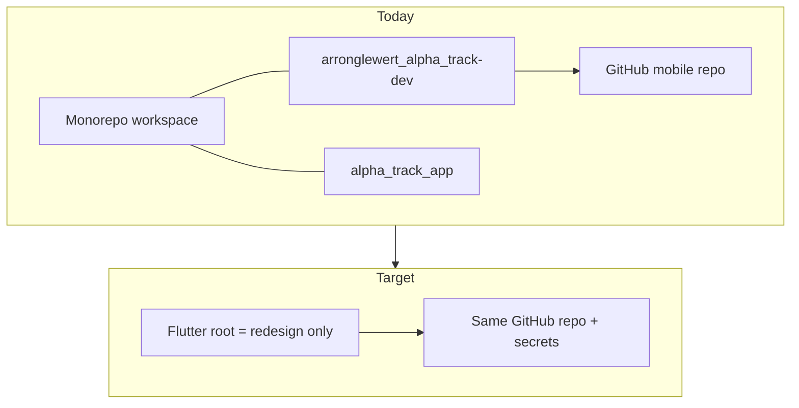

# Mobile GitHub repo migration — Option A (redesign as repo root)

**Strategy:** The existing GitHub repository that today hosts `arronglewert_alpha_track-dev` becomes the **single Flutter app repository**. Its default branch contains **only** the redesign app (`alpha_track_app` contents at **repository root**), not the full monorepo. **GitHub Actions secrets and the `mobile-release` environment stay on that same repo**—no secret migration unless Firebase or Apple IDs change.

**Canonical app:** `alpha_track_app/` in this workspace → becomes `/` on GitHub.  
**Reference CI source:** [`../arronglewert_alpha_track-dev/`](../arronglewert_alpha_track-dev/) (workflows, `ci/`, `fastlane/`, `MOBILE_CI_CD.md`).  
**Production Android ID:** `com.marcgelwertz.alphatrack` (already in redesign `android/app/build.gradle.kts` and legacy `ci/prepare_release.py`).

**Related:** [BACKEND_INTEGRATION_PLAN.md](BACKEND_INTEGRATION_PLAN.md) Phase 6, [MOBILE_RELEASE_PLAN.md](../MOBILE_RELEASE_PLAN.md), [PRODUCTION_READINESS_GATE.md](PRODUCTION_READINESS_GATE.md) (run before or in parallel with first internal upload).

### Release priority (same as legacy)

**Android first.** The immediate goal is a **green Mobile CI** and a **signed AAB** deployed to **Google Play internal testing** via **Mobile release** (CI/CD). Treat that path as **M0–M6**; do not block Android work on Apple signing, provisioning, or iOS Firebase.

**iOS later.** TestFlight / App Store Connect automation (**M7**) starts only after Android internal upload is done and the team explicitly picks it up. Until then:

- Run **Mobile release** with platform **`android`** only (never `ios` or `both` in this phase).
- **Android-related** GitHub secrets must be correct before **M5**; **iOS** secrets stay documented in [`.env.example`](.env.example) but are **not** required for exit criteria **M4–M6**.
- **M0.3** (bundle ID / iOS Firebase) is a **note for later**, not a gate for landing CI or Play internal.

---

## Architecture (Option A)



| | Monorepo (local) | GitHub mobile repo |
|--|------------------|-------------------|
| **Keeps** | `time-tracker/`, dashboards, docs, optional `legacy/` archive | N/A |
| **Publishes** | Copy/sync `alpha_track_app/*` to a clean git root | `main` / `dev` = redesign only |
| **Does not push** | Entire monorepo as one remote (unless you later choose Option B) | — |

---

## Phase M0 — Preconditions and decisions

**Goal:** Avoid a broken first CI run or wrong store identity.

### Checklist

- [ ] **M0.1** Confirm GitHub repo URL and admin access (Settings → Secrets, Environments → `mobile-release`).
- [ ] **M0.2** Confirm branch policy: `main` + `dev`; PRs to `main`; Android release on tags `v*.*.*` (see legacy [MOBILE_CI_CD.md](../arronglewert_alpha_track-dev/MOBILE_CI_CD.md)).
- [ ] **M0.3** **(Deferred — iOS only)** Bundle ID / Firebase for Apple: legacy `ci/prepare_release.py` has `IOS_APP_ID = com.marc.alphatrack`; redesign targets `com.marcgelwertz.alphatrack`. **Resolve with client when starting M7**, not before Android CI/Play internal.
- [ ] **M0.4** **Android Firebase:** Secret `ANDROID_GOOGLE_SERVICES_JSON_BASE64` must be the JSON for `com.marcgelwertz.alphatrack` (CI writes `android/app/google-services.json`; file is gitignored locally).
- [ ] **M0.5** Agree git history strategy (pick one):
  - **M0.5a (recommended):** New branch `redesign/main` with redesign-at-root; merge to `main` via PR (preserves history).
  - **M0.5b:** Replace `main` in one push (only if team accepts losing legacy default-branch history on GitHub).
- [ ] **M0.6** Tag legacy on GitHub before cutover: e.g. `legacy/final` or `v-legacy-last` pointing at last legacy commit.

### Exit criteria

- **Android** secrets inventory complete for CI (keystore, `ANDROID_GOOGLE_SERVICES_JSON_BASE64`, Play JSON when upload is planned).
- GitHub secrets naming matches [MOBILE_CI_CD.md § Add GitHub Secrets](../arronglewert_alpha_track-dev/MOBILE_CI_CD.md) (iOS entries may remain empty until M7).

---

## Phase M1 — Prepare redesign tree as publishable root

**Goal:** A directory that is exactly what will be pushed to GitHub (Flutter at root).

### Checklist

- [ ] **M1.1** Create a clean working tree (separate clone or export):
  ```bash
  # Example: export redesign only
  rsync -a --exclude build --exclude .dart_tool \
    alpha_track_app/ /path/to/mobile-repo-root/
  ```
- [ ] **M1.2** Verify at export root: `pubspec.yaml`, `lib/`, `android/`, `ios/`, `test/`, `.fvmrc` (Flutter **3.38.5**, matches legacy CI).
- [ ] **M1.3** Ensure `.gitignore` covers `android/key.properties`, keystores, `google-services.json`, local signing—same as legacy expectations.
- [ ] **M1.4** Local sanity (from export root):
  ```bash
  flutter pub get
  flutter analyze --no-fatal-infos --no-fatal-warnings
  flutter test
  ```
- [ ] **M1.5** Optional local release smoke (signing files on your machine only):
  ```bash
  flutter build apk --release
  # or use tool/prepare-android-build.sh if you rely on gradle-local.properties
  ```

### Exit criteria

- Analyze + tests pass from export root.
- No monorepo-only paths in `pubspec.yaml` or imports.

---

## Phase M2 — Port CI/CD from legacy into export root

**Goal:** GitHub runs the same pipelines against the redesign codebase.

### Files to copy (from `arronglewert_alpha_track-dev/` → repo root)

| Path | Purpose |
|------|---------|
| `.github/workflows/mobile-ci.yml` | PR/push checks |
| `.github/workflows/mobile-release.yml` | Tagged + manual release |
| `ci/prepare_release.py` | Signing + Firebase materialization |
| `ci/check_android_permissions.py` | Release permission guard |
| `ci/test_*.py` | CI unit tests for release scripts |
| `fastlane/Fastfile` | Play internal + TestFlight |
| `Gemfile` / `Gemfile.lock` (if present) | Ruby deps for fastlane |
| [`.env.example`](.env.example) | Documented secret names (committed); mirror of legacy `.env` keys |

Also copy or adapt **[MOBILE_CI_CD.md](../arronglewert_alpha_track-dev/MOBILE_CI_CD.md)** to repo root as operator runbook.

### `.env.example` (GitHub secrets checklist)

Legacy kept real values in **gitignored** [`.env`](../arronglewert_alpha_track-dev/.env) as a private copy-paste aid for GitHub Secrets. There was no committed `.env.example`; redesign adds one so the mobile repo documents every name in one place.

**Task:** When exporting to GitHub (Option A root), include [`.env.example`](.env.example) and ensure `.gitignore` allows `!.env.example` while ignoring `.env` / `.env.local`.

| Variable | Purpose |
|----------|---------|
| `ANDROID_KEYSTORE_BASE64` | Production upload keystore for signed AAB/APK on CI |
| `ANDROID_KEY_ALIAS` | Key alias inside the keystore |
| `ANDROID_STORE_PASSWORD` / `ANDROID_KEY_PASSWORD` | Keystore and key passwords |
| `ANDROID_GOOGLE_SERVICES_JSON_BASE64` | Injects `android/app/google-services.json` on CI |
| `PLAY_SERVICE_ACCOUNT_JSON` | Play internal upload (plain JSON, not base64) |
| `IOS_*` / `APP_STORE_CONNECT_KEY_*` | **Deferred (M7)** — TestFlight; not needed for Android-only CI |

**Not in `.env` (documented in `.env.example` comments):** Flutter `--dart-define=SOCKET_URL=...` and `DEMO_MODE=true`; local-only `android/key.properties` for machine builds.

If you maintain a private `.env` locally, copy from legacy **keys only**—rotate anything that may have leaked; never commit `.env`.

### Checklist

- [x] **M2.1** Copy assets above; commit in the mobile-repo branch. _(Copied into workspace `alpha_track_app/` — push via M3.)_
- [x] **M2.2** Review `ci/prepare_release.py`: `ANDROID_APP_ID` = `com.marcgelwertz.alphatrack`. Leave `IOS_APP_ID` as-is until **M7** (no iOS release runs in M4–M6).
- [x] **M2.3** **Java in workflow:** Legacy release uses Java **17**; redesign `build.gradle.kts` targets JVM **11**—17 is fine on CI. If Gradle fails, try `java-version: "21"` in `mobile-release.yml` to match local Fedora setup, or align AGP locally to 17.
- [x] **M2.4** Confirm `flutter build appbundle` runs from repo root (no `working-directory` needed—Option A benefit). _(Local: `flutter test` + `ci` unittest pass; appbundle when signing/`google-services.json` present.)_
- [ ] **M2.5** Update [BACKEND_INTEGRATION_PLAN.md](BACKEND_INTEGRATION_PLAN.md) Phase **6.1** when port is merged (checkbox + link to this doc).
- [x] **M2.6** Commit [`.env.example`](.env.example) at repo root; confirm `.gitignore` ignores `.env` but keeps `.env.example`. Optionally copy populated values from legacy `.env` into a **local** `.env` (gitignored) for secret rotation—do not commit.

### Exit criteria

- `ruby -c fastlane/Fastfile` and `python3 -m unittest discover -s ci -p 'test_*.py'` pass locally from export root.
- **Workspace status (2026-10-14):** CI tree copied under `alpha_track_app/`; `python3 -m unittest discover -s ci -p 'test_*.py'` OK; Android manifests aligned with legacy permission guard. **Next:** M3 push to legacy GitHub remote (`arronglewert_alpha_track-dev/.git`).

---

## Phase M3 — Wire GitHub remote and land on `main`

**Goal:** Same remote as legacy; default branch builds redesign.

### Checklist

- [ ] **M3.1** In export root:
  ```bash
  git init   # only if new clone; otherwise clone existing repo and replace tree
  git remote add origin <EXISTING_LEGACY_GITHUB_URL>   # or set-url
  ```
- [ ] **M3.2** Push branch (example PR flow):
  ```bash
  git checkout -b redesign/main
  git add -A
  git commit -m "Replace app with 2026 redesign; port mobile CI/CD"
  git push -u origin redesign/main
  ```
  Open PR → `main`; do **not** delete secrets when merging.
- [ ] **M3.3** After merge, tag legacy pointer if not done in M0.6.
- [ ] **M3.4** Document in monorepo README (optional): mobile app source of truth is GitHub repo X; `alpha_track_app/` is developed here and synced or subtree-pushed.

### Exit criteria

- `main` on GitHub contains redesign-at-root + `.github/workflows/*`.

---

## Phase M4 — Green Mobile CI

**Goal:** [BACKEND_INTEGRATION_PLAN.md](BACKEND_INTEGRATION_PLAN.md) **6.2** — PR checks pass.

### Checklist

- [ ] **M4.1** Open PR to `main` (or push to `dev`) and wait for **Mobile CI**.
- [ ] **M4.2** Fix failures common on first run:
  - `pubspec.lock` out of date → run `flutter pub get` locally, commit lockfile.
  - Analyzer errors → fix in redesign.
  - `ci/` test failures → adjust scripts only if paths/IDs changed.
- [ ] **M4.3** Confirm workflow uses `.fvmrc` Flutter 3.38.5.

### Exit criteria

- **Mobile CI** green on PR to `main`.

---

## Phase M5 — Release artifact (upload off)

**Goal:** [BACKEND_INTEGRATION_PLAN.md](BACKEND_INTEGRATION_PLAN.md) **6.3** partial — signed AAB without store upload.

### Checklist

- [ ] **M5.1** Actions → **Mobile release** → Run workflow on `main`.
- [ ] **M5.2** Inputs: platform `android`, version e.g. `1.0.0`, **unused** `build_number` > Play’s last version code, **Upload = false**.
- [ ] **M5.3** Download AAB artifact; install via internal track manually or `bundletool`/`adb` as needed.
- [ ] **M5.4** Run [PRODUCTION_READINESS_GATE.md](PRODUCTION_READINESS_GATE.md) on that build (device QA).

### Exit criteria

- Signed AAB produced by CI; device smoke started or completed per gate doc.

---

## Phase M6 — Internal Play upload (optional gate)

**Goal:** **6.3** complete — one successful internal testing upload from CI.

### Checklist

- [ ] **M6.1** `PLAY_SERVICE_ACCOUNT_JSON` present; Play Console draft/listing ready if first upload.
- [ ] **M6.2** Re-run **Mobile release** with **Upload = true** (or push tag `v1.0.x` per legacy doc for automatic Android upload).
- [ ] **M6.3** Verify build in Play internal testing; testers install from Play.
- [ ] **M6.4** [BACKEND_INTEGRATION_PLAN.md](BACKEND_INTEGRATION_PLAN.md) **6.4** — Play FGS/location/data safety/reviewer credentials (store console, not only code).

### Exit criteria

- One internal track build from CI; Phases **0–4** exit criteria met per product agreement.

---

## Phase M7 — iOS CI (**out of scope until Android is live on internal**)

**Start only after M6 exit criteria are met** and product asks for TestFlight. Not part of the current migration push.

**Goal:** TestFlight path; often blocked on Firebase plist / bundle ID (see `ios/Runner/FIREBASE_SETUP.md`). Complete **M0.3** before first `ios` workflow run.

### Checklist

- [ ] **M7.1** Update secrets for correct `GoogleService-Info.plist` and distribution profile.
- [ ] **M7.2** Manual **Mobile release** with `ios` or `both`, Upload off first; commit `Gemfile.lock` / `Podfile.lock` from artifact if first macOS run (per MOBILE_CI_CD.md).
- [ ] **M7.3** Upload to TestFlight when Firebase + signing verified.

### Exit criteria

- IPA artifact from CI; TestFlight upload optional per client timeline.

---

## Phase M8 — Monorepo hygiene (local workspace)

**Goal:** Clarity for developers; legacy folder not confused with production remote.

### Checklist

- [ ] **M8.1** Mark `arronglewert_alpha_track-dev/` as **archived reference** in monorepo README (do not delete until team agrees).
- [ ] **M8.2** Single workflow: feature branches in `alpha_track_app/` → periodic sync/push to GitHub mobile repo (document rsync or `git subtree` command).
- [ ] **M8.3** Update decision matrix **B-10** in BACKEND_INTEGRATION_PLAN when **6.2** is green.

### Exit criteria

- Team knows which remote receives releases; legacy not deployed accidentally.

---

## Secret reuse cheat sheet (same GitHub repo)

No re-entry if names unchanged. Verify values still match redesign:

| Secret | Redesign relevance |
|--------|-------------------|
| `ANDROID_KEYSTORE_*` | Same Play app `com.marcgelwertz.alphatrack` |
| `ANDROID_GOOGLE_SERVICES_JSON_BASE64` | Must include `com.marcgelwertz.alphatrack` client |
| `PLAY_SERVICE_ACCOUNT_JSON` | Same Play app |
| `IOS_*` / App Store Connect | **M7 only** — must match bundle ID decided in M0.3 |

Full list: [MOBILE_CI_CD.md](../arronglewert_alpha_track-dev/MOBILE_CI_CD.md).

---

## Risks and mitigations

| Risk | Mitigation |
|------|------------|
| Push monorepo by mistake | Option A: only export `alpha_track_app/` to mobile remote |
| iOS profile vs bundle mismatch | Android path unaffected; resolve in M0.3 before M7 |
| iOS work distracts from Play ship | Policy: `android` only on Mobile release until M6 done |
| Version code collision | Use unused `build_number` in manual release; bump `pubspec` build number base per MOBILE_CI_CD |
| QA skipped | Require PRODUCTION_READINESS_GATE before M6 upload |
| Two sources of truth | M8.2 documented sync from monorepo `alpha_track_app/` to GitHub |

---

## Suggested timeline

| Phase | Typical effort |
|-------|----------------|
| M0 | 0.5 day (client IDs + git policy) |
| M1–M2 | 1 day (export + port CI) |
| M3–M4 | 0.5 day (PR + fix CI) |
| M5–M6 | 1 day (artifact + gate QA + Play internal) — **current target** |
| M7 | Deferred (1–2 days when Android internal is done) |
| M8 | 0.5 day (docs); can run in parallel after M4 |

---

## Tracking linkage

| Integration plan item | Migration phase |
|----------------------|-----------------|
| 6.1 Port CI/Fastlane | M2 |
| 6.2 Green mobile-ci | M4 |
| 6.3 Signed **AAB** / Play internal upload | M5–M6 (Android only) |
| 6.4 Play store policy | M6 |
| iOS / TestFlight | M7 (after 6.3 Android) |

Update checkboxes in [BACKEND_INTEGRATION_PLAN.md](BACKEND_INTEGRATION_PLAN.md) as each exit criterion is met.
