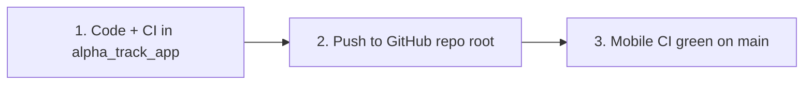

# Mobile GitHub repo — Option A (redesign at repo root)

**What Option A means:** The existing mobile repo (`alphatrack888/arronglewert_alpha_track-dev`) stays the same remote with the same GitHub secrets and `mobile-release` environment. **`main` should contain only the redesign app** — the contents of workspace `alpha_track_app/` at the **repository root** (not nested in a folder).

| | Local workspace | GitHub |
|--|-----------------|--------|
| Develop | `alpha_track_app/` | — |
| Publish | rsync → mobile git clone → push | `main` / `dev` = Flutter at root |
| Keep local only | `time-tracker/`, dashboards, legacy clone | — |

**Android app ID:** `com.marcgelwertz.alphatrack`  
**Flutter (CI):** `.fvmrc` → **3.38.5**  
**Operator runbook:** [MOBILE_CI_CD.md](MOBILE_CI_CD.md)  
**Secrets names:** [`.env.example`](.env.example)

**Priority:** Android CI and releases first. iOS / TestFlight is a separate follow-up when you need it.

---

## What you are doing (three steps)



1. **Code and CI locally** — Redesign lives in `alpha_track_app/` with workflows and scripts at that folder’s root (same layout as GitHub after cutover).
2. **GitHub repo** — Replace the mobile repo tree with that folder; tag legacy code so old `main` is not lost.
3. **Sanity** — Analyzer, tests, and `ci/` Python tests pass; GitHub **Mobile CI** matches that.

You do **not** need to build an APK/AAB or open a PR at every sub-step. Release builds and Play upload are **after** the repo and CI are in place (see [MOBILE_CI_CD.md](MOBILE_CI_CD.md)).

---

## Step 1 — Local tree (code + CI/CD)

**Goal:** `alpha_track_app/` is exactly what GitHub `main` should look like.

### App quality (run from `alpha_track_app/`)

```bash
flutter pub get
flutter analyze --no-fatal-infos --no-fatal-warnings
flutter test
python3 -m unittest discover -s ci -p 'test_*.py'
```

### CI/CD files (already ported from legacy `arronglewert_alpha_track-dev/`)

| Path | Role |
|------|------|
| `.github/workflows/mobile-ci.yml` | PR/push checks |
| `.github/workflows/mobile-release.yml` | Tagged + manual release |
| `ci/` | `prepare_release.py`, permission checks, tests |
| `fastlane/Fastfile`, `Gemfile` | Play / TestFlight |
| `MOBILE_CI_CD.md`, `.env.example` | How to run CI and name secrets |

**`ci/prepare_release.py`:** `ANDROID_APP_ID` = `com.marcgelwertz.alphatrack`. iOS ID in that file is legacy until you do an iOS release.

**Do not commit:** `android/key.properties`, keystores, `android/app/google-services.json` (CI injects Firebase via `ANDROID_GOOGLE_SERVICES_JSON_BASE64`).

---

## Step 2 — GitHub cutover

**Remote:** `git@github.com:alphatrack888/arronglewert_alpha_track-dev.git`  
**Legacy pointer:** Tag last legacy `main` before replacing files, e.g. `legacy/final` → push tag.

**Recommended flow:** branch `redesign/main` with the new tree, merge to `main` when ready (keeps history). Alternative: replace `main` in one push only if the team accepts that.

From a clone of the mobile repo (not the whole monorepo):

```bash
git checkout main && git pull
git tag legacy/final && git push origin legacy/final   # once, before cutover

git checkout -b redesign/main
# Replace everything except .git with alpha_track_app contents:
find . -mindepth 1 -maxdepth 1 ! -name '.git' -exec rm -rf {} +
rsync -a --exclude build --exclude .dart_tool /path/to/alpha_track_app/ ./

git add -A
git commit -m "Replace app with 2026 redesign; port mobile CI/CD"
git push -u origin redesign/main
```

Merge `redesign/main` → `main` on GitHub (or push directly to `main` if that is your policy). **Do not remove** existing repo secrets when merging.

**Workspace note:** `alpha_track_app/` has no `.git`; git lives in `arronglewert_alpha_track-dev/`. After a cutover, develop in `alpha_track_app/` and rsync + commit in the mobile clone when publishing.

### Status (2026-10-14)

| Item | State |
|------|--------|
| CI/CD in `alpha_track_app/` | Done |
| Tag `legacy/final` on GitHub | Done |
| Branch `redesign/main` pushed | Done (`bc6f4c3`) |
| `main` = redesign | **Pending merge** (open PR or merge when ready) |

---

## Step 3 — Verify on GitHub

After `main` has the redesign at root:

1. **Mobile CI** — Triggered on PR/push to `main` (and push to `dev`). Should run: `flutter pub get --enforce-lockfile`, analyze, `flutter test`, `ci/` unittest, `ruby -c fastlane/Fastfile`.
2. **If CI fails** — Usual fixes: commit `pubspec.lock`, analyzer errors in app code, path/ID tweaks in `ci/` only if something real changed.
3. **Secrets (before release, not for basic CI analyze/test)** — Repo admin; environment `mobile-release`. Android Firebase secret must be for **`com.marcgelwertz.alphatrack`**. Full list: `.env.example` and `MOBILE_CI_CD.md`.

Local release build (`flutter build appbundle`) is optional and only needed on your machine or when you run **Mobile release** in Actions.

---

## Later (out of scope for “repo + CI”)

| When | What |
|------|------|
| Signed AAB from CI | **Mobile release**, platform `android`, upload off → artifact |
| Play internal | Same workflow, upload on + `PLAY_SERVICE_ACCOUNT_JSON` |
| iOS / TestFlight | Update iOS Firebase/bundle secrets; platform `ios` in release workflow |
| Monorepo docs | README: develop in `alpha_track_app/`, publish via mobile clone |

**Related:** [BACKEND_INTEGRATION_PLAN.md](BACKEND_INTEGRATION_PLAN.md) Phase 6, [PRODUCTION_READINESS_GATE.md](PRODUCTION_READINESS_GATE.md) before store upload.

---

## Risks (short)

| Risk | Mitigation |
|------|------------|
| Push whole monorepo | Only rsync **`alpha_track_app/`** |
| Lose legacy on GitHub | Tag **`legacy/final`** before cutover |
| Wrong Firebase package | `ANDROID_GOOGLE_SERVICES_JSON_BASE64` for redesign package ID |
| Two sources of truth | One publish path: rsync `alpha_track_app/` → mobile repo |
